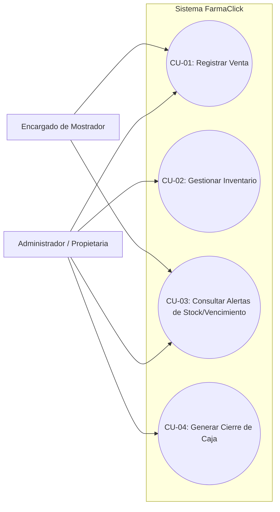
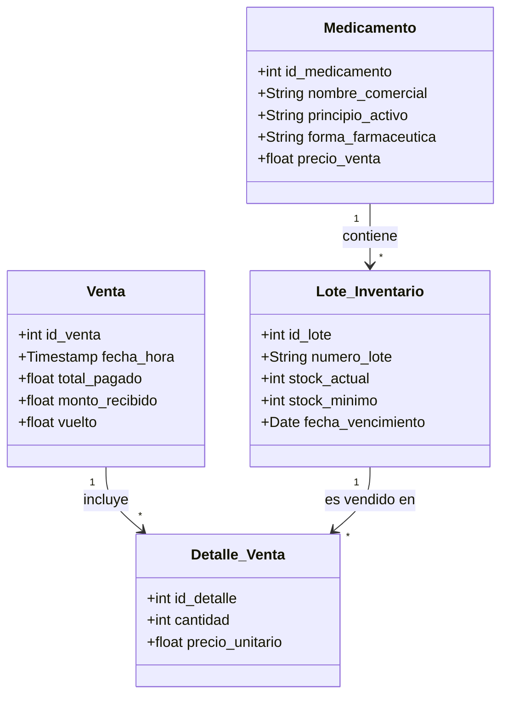
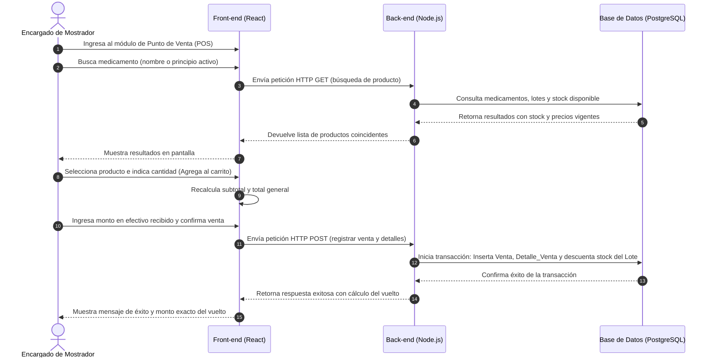

[← Volver al inicio](index.md)

# Entrega 2 · Análisis

> *Qué debe hacer el sistema, desde la perspectiva del negocio y del usuario.*

---

## 1. Requisitos funcionales

| ID | Requisito | Prioridad |
|---|---|---|
| RF-01 | El sistema debe permitir registrar, modificar, consultar y dar de baja medicamentos (CRUD), gestionando nombre comercial, principio activo, lote, precio de venta, stock actual, stock mínimo y fecha de vencimiento[cite: 1]. | Alta |
| RF-02 | El sistema debe permitir buscar productos rápidamente por nombre o principio activo y agregarlos al carrito de compra en el módulo de punto de venta[cite: 1]. | Alta |
| RF-03 | El sistema debe calcular automáticamente el total a cobrar y el vuelto según el monto entregado por el cliente[cite: 1]. | Alta |
| RF-04 | El sistema debe descontar de forma automática las cantidades correspondientes del inventario general al confirmar una venta[cite: 1]. | Alta |
| RF-05 | El sistema debe mostrar un aviso visual o alerta cuando un producto alcance o baje de su stock mínimo preestablecido[cite: 1]. | Media |
| RF-06 | El sistema debe generar un reporte o listado de alerta con los medicamentos próximos a su fecha de caducidad[cite: 1]. | Media |
| RF-07 | El sistema debe permitir generar un resumen del total de ingresos monetarios obtenidos en el cierre de caja diario[cite: 1]. | Baja |

---

## 2. Requisitos no funcionales

| ID | Requisito | Categoría |
|---|---|---|
| RNF-01 | Las consultas de búsqueda de medicamentos en el mostrador y el registro de ventas deben completarse en menos de 2 segundos[cite: 1]. | Rendimiento |
| RNF-02 | El acceso a las funciones administrativas (modificación de precios y gestión de inventario) requerirá autenticación básica de usuario[cite: 1]. | Seguridad |
| RNF-03 | La interfaz gráfica debe ser intuitiva, con botones grandes y flujos cortos, permitiendo su uso sin requerir conocimientos técnicos avanzados[cite: 1]. | Usabilidad |
| RNF-04 | El sistema debe garantizar la consistencia de los datos mediante transacciones seguras en la base de datos relacional para evitar pérdidas de información[cite: 1]. | Confiabilidad |

---


## 3. Modelo de casos de uso

**Diagrama de casos de uso del sistema:**



**Especificación de casos de uso principales:**

### CU-01 · Registrar Venta

* **Actor(es):** Encargado de Mostrador, Administrador / Propietaria[cite: 1]
* **Precondición:** 
  1. El usuario ha iniciado sesión en el sistema con un perfil autorizado[cite: 1].
  2. Los medicamentos deben estar previamente cargados en la base de datos con precio de venta y stock disponible mayor a cero.
* **Flujo principal:**
  1. El usuario ingresa al módulo de Punto de Venta.
  2. El usuario busca el medicamento por nombre o principio activo.
  3. El sistema muestra los resultados coincidentes con su stock y precio.
  4. El usuario selecciona el producto e indica la cantidad deseada para agregarlo al carrito[cite: 1].
  5. El sistema recalcula el subtotal y el total general de la venta.
  6. El usuario ingresa el monto en efectivo entregado por el cliente y el sistema calcula el vuelto.
  7. El usuario confirma la venta.
  8. El sistema descuenta el stock de los productos vendidos y registra la transacción.
* **Flujos alternativos:**
  * **Stock insuficiente:** Si la cantidad solicitada supera el stock actual, el sistema muestra una advertencia impidiendo agregar el producto hasta ajustar la cantidad.
* **Postcondición:** El inventario queda actualizado y la venta queda registrada para el arqueo diario.

---

### CU-02 · Gestionar Inventario

* **Actor(es):** Administrador / Propietaria.
* **Precondición:** Ninguna.
* **Flujo principal:**
  1. El usuario accede al módulo de inventario.
  2. Selecciona la opción de agregar un nuevo medicamento o editar uno existente.
  3. Completa o modifica los campos obligatorios (nombre, lote, precio, stock, fecha de vencimiento).
  4. El usuario guarda los cambios.
  5. El sistema valida los datos y actualiza la base de datos.
* **Flujos alternativos:**
  * **Datos incompletos:** Si falta algún campo obligatorio, el sistema muestra un mensaje de error y solicita completarlo.
* **Postcondición:** Los cambios se reflejan inmediatamente en las consultas de mostrador y control de stock.

---

### CU-03 · Consultar Alertas de Stock/Vencimiento

* **Actor(es):** Encargado de Mostrador, Administrador / Propietaria.
* **Precondición:** El usuario se encuentra autenticado y accede al panel principal del sistema.
* **Flujo principal:**
  1. El usuario accede al módulo o pestaña de Alertas.
  2. El sistema verifica el estado actual del inventario cruzando los datos de stock mínimo y fechas de caducidad.
  3. El sistema muestra el listado detallado de productos con stock crítico y medicamentos próximos a vencer.
  4. El usuario revisa la información para la toma de decisiones.
* **Flujos alternativos:**
  * **Sin alertas activas:** Si no existen productos con stock bajo o por vencer, el sistema muestra un mensaje indicando que todo se encuentra en orden.
* **Postcondición:** El usuario obtiene visibilidad de los riesgos en el inventario sin alterar los datos del sistema.

---

### CU-04 · Generar Cierre de Caja

* **Actor(es):** Administrador / Propietaria
* **Precondición:** Se han registrado transacciones de venta durante la jornada laboral.
* **Flujo principal:**
  1. El usuario selecciona la opción de cierre de caja en el sistema
  2. El sistema procesa y suma el total de ingresos monetarios obtenidos en las ventas del día
  3. El sistema muestra en pantalla el resumen consolidado de la recaudación diaria.
  4. El usuario valida y confirma el cierre de la jornada.
* **Flujos alternativos:**
  * **Sin ventas registradas:** Si el día no registra transacciones, el sistema muestra un total de ingresos igual a cero.
* **Postcondición:** Queda registrado el reporte de ingresos de la jornada para el control financiero del negocio.

---


## 4. Modelo de dominio

**Diagrama de clases conceptual:**



El dominio del sistema se compone de las siguientes entidades principales[cite: 1]:
- **Medicamento:** Representa la información base del producto (nombre comercial, principio activo, forma farmacéutica y precio de venta).
- **Lote_Inventario:** Administra el control físico por cada partida de medicamentos, incluyendo su número de lote, stock actual, stock mínimo y fecha de vencimiento. Un medicamento puede tener múltiples lotes.
- **Venta:** Registra la transacción comercial realizada en el mostrador (fecha y hora, total pagado, monto recibido y vuelto).
- **Detalle_Venta:** Almacena los ítems específicos incluidos en una venta, vinculando la cantidad y precio unitario con el lote correspondiente.

---

## 5. Diagramas de comportamiento

**Diagrama de secuencia — Proceso de Venta (CU-01):**



Este flujo representa la interacción donde el encargado selecciona los productos en la interfaz de **React (Front-end)**, el cual realiza una petición HTTP a la API de **Node.js (Back-end)** para consultar y actualizar la base de datos **PostgreSQL**, procesando el cálculo del vuelto y descontando el stock de forma segura.

---

## 6. Prototipo de interfaz (mockups)

**Pantalla — Punto de Venta (Mostrador):**

```text
+-----------------------------------------------------------------------+
| FarmaClick - Punto de Venta                  [ Usuario: Doris ]       |
+-----------------------------------------------------------------------+
| Buscar producto: [ Paracetamol_________________ ] [ Buscar ]          |
+-----------------------------------------------------------------------+
| RESULTADOS DE BÚSQUEDA:                                               |
| - Paracetamol 500mg (Lote: A123) | Stock: 45 | Gs. 5.000  [ + Agregar ]|
| - Ibuprofeno 400mg  (Lote: B456) | Stock: 12 | Gs. 8.000  [ + Agregar ]|
+-----------------------------------------------------------------------+
| CARRITO DE COMPRAS:                                                   |
| 1x Paracetamol 500mg ................................... Gs. 5.000    |
|-----------------------------------------------------------------------+
| TOTAL A PAGAR: Gs. 5.000                                              |
| Efectivo recibido: [ 10.000___ ]    VUELTO: Gs. 5.000                 |
|                                       [ CANCELAR ]  [ CONFIRMAR VENTA]|
+-----------------------------------------------------------------------+
```
> *Descripción:* Interfaz optimizada para agilizar la atención en el mostrador mediante una barra de búsqueda rápida, visualización de lotes y stock disponible, y el cálculo automatizado del vuelto en efectivo.

**Pantalla — Alertas de Vencimiento y Stock Mínimo:**

```
+-----------------------------------------------------------------------+
| FarmaClick - Alertas del Sistema             [ Volver al Inicio ]     |
+-----------------------------------------------------------------------+
| ⚠️  ALERTAS DE STOCK MÍNIMO:                                          |
|  - Amoxicilina 500mg (Stock actual: 2 | Mínimo: 5)                    |
|                                                                       |
| ⏰ MEDICAMENTOS PRÓXIMOS A VENCER (Menos de 60 días):                 |
|  - Omeprazol 20mg | Lote: C789 | Vence: 15/12/2026 | Stock: 10        |
+-----------------------------------------------------------------------+
```
> *Descripción:* Panel de control visual que advierte de forma anticipada sobre medicamentos con stock crítico o próximos a caducar para prevenir pérdidas económicas en el negocio.

---

## 7. Reglas del negocio

| ID | Regla |
|---|---|
| RN-01 | Ningún medicamento cuyo lote se encuentre vencido podrá ser comercializado ni incluido en una venta activa dentro del sistema |
| RN-02 | El sistema no permitirá registrar una venta si la cantidad solicitada de un medicamento supera el stock físico disponible en el inventario |
| RN-03 | Las modificaciones de precios de venta sólo podrán ser realizadas por el rol de administración y se aplicarán de forma inmediata a las siguientes transacciones |

---

## 8. Matriz de trazabilidad


Relación explícita entre cada requisito funcional y el/los caso(s) de uso que lo satisfacen, garantizando una cobertura completa del sistema[cite: 1]:

| Requisito Funcional | Descripción del Requisito | Caso(s) de Uso Relacionado(s) |
|---|---|---|
| **RF-01** | Gestión de Medicamentos (CRUD) | CU-02 (Gestionar Inventario) |
| **RF-02** | Búsqueda rápida de productos por nombre o principio activo | CU-01 (Registrar Venta)|
| **RF-03** | Cálculo automático del total a cobrar y el vuelto | CU-01 (Registrar Venta)|
| **RF-04** | Descuento automático del stock general al confirmar venta | CU-01 (Registrar Venta) |
| **RF-05** | Avisos visuales o alertas de stock mínimo | CU-03 (Consultar Alertas de Stock/Vencimiento) |
| **RF-06** | Reporte o listado de medicamentos próximos a vencer | CU-03 (Consultar Alertas de Stock/Vencimiento)|
| **RF-07** | Resumen de ingresos monetarios para el cierre de caja diario | CU-04 (Generar Cierre de Caja) |
---

[← Anterior: Conceptualización](conceptualizacion.md) · [Siguiente: Diseño →](diseno.md)
